<picture>
  <source media="(prefers-color-scheme: dark)" srcset="assets/banner-dark.svg">
  <source media="(prefers-color-scheme: light)" srcset="assets/banner-light.svg">
  
</picture>

<p align="center">
  <a href="https://www.linkedin.com/in/tronganhwork/"></a>
  <a href="mailto:tronganh.work@gmail.com"></a>
  
</p>

## 👋 About me

I studied Information Security at the **University of Information Technology (UIT), VNU-HCM** and spent eight months at **InSecLab** researching how deep learning can find vulnerabilities in source code. I'm now taking that detection mindset to the blue team: monitoring events, triaging alerts and investigating incidents.

```yaml
name:       La Trong Anh
role:       Security Engineer (fresher)
education:  Information Security @ University of Information Technology (UIT), VNU-HCM
experience: Software Security Research Intern @ InSecLab, UIT
focus:      [threat detection, log analysis, IDS/IPS, incident response]
languages:  [Vietnamese (native), English (TOEIC 590 / VSTEP B2)]
```

## 💼 Experience

**Software Security Research Intern** · InSecLab, UIT
<sub>Sep 2023 – Apr 2024 · Ho Chi Minh City</sub>

- Researched deep-learning-based vulnerability detection for C/C++ code using code property graphs, graph attention networks and code language models
- Co-built a multimodal detector that raised F1-score from **0.70 to 0.84** over a graph-only baseline, with explainable line-level results
- Shipped the research as a VS Code extension backed by a Flask REST API and Dockerized Joern; submitted to the **Eureka 2024** Student Research Award

## 🛠️ Skills & tools

| Area | Tools |
|---|---|
| **Detection & network security** |       |
| **Systems & networking** |     |
| **Programming & tooling** |         |
| **Security research & ML** |     |

**Core knowledge:** IDS/IPS · network traffic analysis · OWASP Top 10 & CWE · static code analysis (SAST) · incident response · digital forensics · TCP/IP, firewall, VPN, iptables

## 🚀 Projects

| Project | Focus | Stack |
|---|---|---|
| [CoVulPecker](https://github.com/tronganhwork/CoVulPecker) | C/C++ vulnerability detection inside VS Code | Python · PyTorch · Joern · TypeScript |
| [LineVD reproduction](https://github.com/tronganhwork/DACN-UIT-ATCL2020-LTA) | Statement-level vulnerability detection with GNNs | Python · DGL · CodeBERT |
<!-- Add new projects as new rows: | [Name](link) | Focus | Stack | -->

---

<p align="center">
  <sub>Security Engineer (fresher) opportunities · Let's connect on <a href="https://www.linkedin.com/in/tronganhwork/">LinkedIn</a></sub>
</p>
